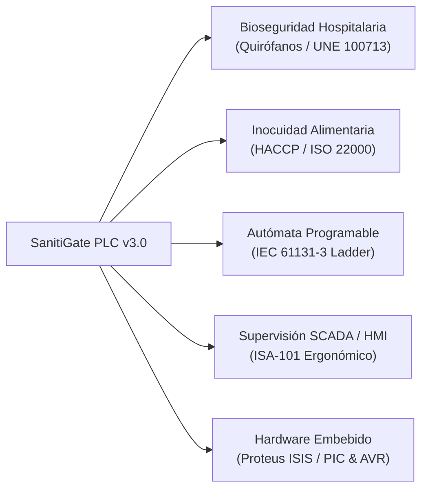
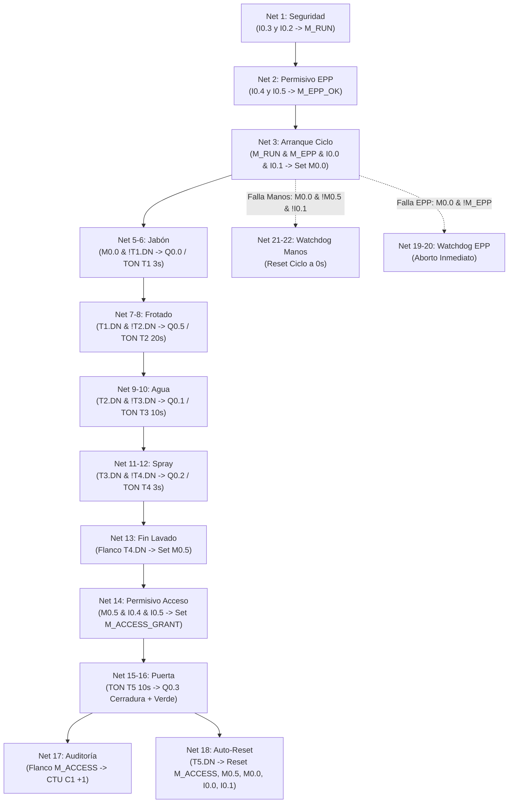

# INFORME TÉCNICO DE INGENIERÍA Y ARQUITECTURA DE SOFTWARE INDUSTRIAL
## SanitiGate PLC v3.0 — Esclusa Sanitaria Automatizada, Validación Integral de EPP y Control Secuencial de Acceso
**Documento Técnico Oficial para Defensa Académica y Auditoría Industrial**  
*Autor: Arquitecto de Software Industrial e Ingeniero de Automatización Senior*  
*Entorno de Simulación: Motor determinístico en JavaScript (20 Hz / 50 ms) y Gráficos Vectoriales SVG / HMI ISA-101*  
*Normativas de Referencia: IEC 61131-3, ISA-101, UNE 100713, ISO 14644-1 (Clase 5-7), HACCP, BPM, Codex Alimentarius*

---

## 1. Identificación y Ficha Técnica del Proyecto



* **Denominación del Sistema:** SanitiGate PLC — Compuerta Automatizada de Higiene, Control de Acceso Sanitario y Validación de Equipos de Protección Personal (EPP).
* **Versión del Firmware / Software:** Release v3.0 (Revisión con interbloqueo de salida de fluidos y auto-reset de presencia).
* **Áreas de Despliegue Objetivo:**
  1. **Sector Médico-Quirúrgico:** Salas de Operaciones, Quirófanos y Unidades de Cuidados Intensivos Asépticas (ambientes Clase ISO 5 a ISO 7 según norma ISO 14644 y UNE 100713).
  2. **Sector Agroalimentario y Farmacéutico:** Esclusas de acceso a salas limpias de procesamiento, fraccionamiento estéril y envasado de alimentos bajo normativas HACCP, BPM y FSSC 22000.
* **Topología de Control:** Control discreto secuencial determinístico con tiempo de escaneo de ciclo de 50 ms (20 Hz), inmune a fluctuaciones temporales de red.
* **Interfaz de Operación:** Arquitectura *Touchless* (cero contacto físico) con supervisión en tiempo real mediante baliza industrial tricolor e indicadores HMI conforme a ISA-101.

---

## 2. Resumen Ejecutivo y Planteamiento del Problema

### 2.1. El Problema Crítico de la Contaminación Cruzada
En instalaciones de alta exigencia sanitaria, el ser humano constituye el **vector biológico y físico más activo y peligroso**:

1. **Dispersión Capilar (Peligro Físico y Biológico):** Un individuo pierde entre 50 y 100 cabellos por día de manera natural. Cada hebra de cabello transporta colonias de *Staphylococcus aureus* (incluidas cepas meticilino-resistentes MRSA) y *Staphylococcus epidermidis*. En quirófanos, la caída de un cabello en el campo operatorio es causa directa de Infecciones del Sitio Quirúrgico (ISQ); en la industria alimentaria, representa no conformidades críticas y retiro masivo de lotes.
2. **Aerosoles y Microgotas Respiratorias:** Al exhalar, hablar o toser, se generan aerosoles cargados de flora nasofaríngea y patógenos virales. El cubrebocas quirúrgico actúa como filtro de retención bacteriana (BFE $\ge$ 98%). Su mal uso (cubriendo solo la boca o bajo la barbilla) anula toda protección.
3. **Fómites Vivos en Manos:** La flora bacteriana transitoria adquirida en zonas no estériles contiene enterobacterias (*Escherichia coli*, *Salmonella spp.*, *Klebsiella*). La OMS y el Codex Alimentarius determinan que se requiere un mínimo de **20 segundos de fricción mecánica continua con jabón**, sumados a enjuague y desinfección hidroalcohólica, para romper la envoltura lipídica de virus y bacterias.

### 2.2. La Falla Estructural de la Supervisión Humana
Tradicionalmente, el control de acceso a estas áreas se ha delegado en la disciplina del operario o en guardias de seguridad. La ingeniería de confiabilidad humana demuestra que este modelo colapsa por:
* **Fatiga cognitiva y monotonía** tras las primeras 2 horas de turno.
* **Complacencia y sesgo de urgencia:** personal con prisa o jerarquías médicas que omiten el lavado completo o cruzan con la mascarilla mal ajustada.
* **Falta de auditoría criptográfica/inmutable:** no existen registros fidedignos de cuántas personas cumplieron el 100% de la técnica.

### 2.3. La Solución Mecatrónica SanitiGate PLC
SanitiGate sustituye la supervisión humana subjetiva por un **interbloqueo lógico gobernado por PLC**: una cerradura electromagnética de retención física (600 lbs) que **únicamente se libera si se verifican simultáneamente 3 condiciones obligatorias**:
$$\text{Liberación Puerta } (Q_{0.3}) = I_{0.4} \,(\text{Cofia OK}) \;\cdot\; I_{0.5} \,(\text{Mascarilla OK}) \;\cdot\; M_{0.5} \,(\text{Lavado 46s Concluido})$$

Si el operario retira las manos o se quita cualquier implemento de EPP antes de terminar, el sistema aborta de inmediato a 0 segundos, emite una alarma audiovisual y mantiene la compuerta bloqueada.

---

## 3. Arquitectura Funcional: Los 4 Modos Modulares del Simulador

Para fines pedagógicos, de capacitación y de defensa técnica, el sistema dispone de un selector superior en la Pestaña 1 que permite aislar y estudiar cada subsistema o evaluar la línea completa:

```
┌─────────────────────────────────────────────────────────────────────────────────────────────────┐
│                       SELECTOR DE MODOS DE VISUALIZACIÓN / SUBSISTEMAS                          │
├──────────────────────────┬──────────────────────────┬──────────────────────────┬────────────────┤
│ Modo 1: Cofia (I0.4)     │ Modo 2: Mascarilla (I0.5)│ Modo 3: Manos (5 Etapas) │ Modo 4: Total  │
└──────────────────────────┴──────────────────────────┴──────────────────────────┴────────────────┘
```

### Modo 1: Subsistema de Verificación de Cabello (Cofia / Gorro Quirúrgico)
* **Objetivo:** Auditar la cobertura capilar completa antes de habilitar el ingreso.
* **Sensor Asignado:** Sensor Óptico de Visión Artificial Superior (`I0.4`).
* **Comportamiento Dinámico:**
  * Al conmutar `I0.4 = 1`: El escáner cenital emite un haz cónico cian; el avatar muestra su cofia azul ajustada.
  * Al conmutar `I0.4 = 0`: El haz se torna rojo intermitente; el avatar muestra cabello expuesto. El PLC enciende la alarma de bioseguridad capilar, enclava la baliza roja (`Q0.4 = 1`) y bloquea cualquier arranque de ciclo.

### Modo 2: Subsistema de Verificación de Cubrebocas (Mascarilla Facial)
* **Objetivo:** Validar la oclusión hermética del tabique nasal y la boca.
* **Sensor Asignado:** Sensor Facial Infrarrojo de Contorno (`I0.5`).
* **Comportamiento Dinámico:**
  * Al conmutar `I0.5 = 1`: El marco de reconocimiento facial se ilumina en azul clínico; el avatar viste mascarilla quirúrgica con triple pliegue.
  * Al conmutar `I0.5 = 0`: El marco se torna rojo con advertencia de falla respiratoria; la boca y nariz del avatar quedan desprotegidas, emitiendo una alarma de dispersión de aerosoles y bloqueando la esclusa.

### Modo 3: Subsistema de Higiene Secuencial de Manos (5 Etapas / 46 Segundos)
* **Objetivo:** Garantizar la antisepsia estricta de extremidades superiores conforme al protocolo de la OMS.
* **Cronograma de Etapas Mutuamente Excluyentes:**
  1. *Etapa 1 — Dosificación de Jabón (`Q0.0`):* 3.0 segundos con electroválvula de jabón activada y animación de gotas viscosas.
  2. *Etapa 2 — Frotado Mecánico Obligatorio (`Q0.5`):* 20.0 segundos de fricción mecánica vigorosa. Baliza amarilla encendida y avatar frotándose activamente las palmas, dorso y espacios interdigitales.
  3. *Etapa 3 — Enjuague Continuo con Agua (`Q0.1`):* 10.0 segundos de electroválvula de agua abierta con cascada laminar continua.
  4. *Etapa 4 — Atomización de Spray Desinfectante (`Q0.2`):* 3.0 segundos de pulverización de microgotas hidroalcohólicas (etanol al 70%).
  5. *Etapa 5 — Ventana de Desbloqueo de Puerta (`Q0.3`):* 10.0 segundos de liberación del electroimán y baliza verde para el cruce peatonal.
* **Protección Watchdog Anti-Abandono:** Si el sensor óptico de manos (`I0.1`) detecta que el usuario retira las manos en las etapas 1 a 4, el PLC resetea inmediatamente todos los temporizadores a 0.0s, mantiene la cerradura bloqueada y genera una alerta por protocolo incompleto.

### Modo 4: Sistema Integrado Completo (Esclusa de Acceso Total)
* **Objetivo:** Coordinación sincrónica de todos los módulos en una línea de acceso ininterrumpida.
* **Lógica Permisiva:**
  * Si el operario ingresa a la esclusa (`I0.0 = 1`) pero no coloca las manos, el display HMI indica:  
    `"OPERARIO EN ESCLUSA: COLOQUE LAS MANOS BAJO EL LAVAMANOS (I0.1)"` y **no** derrocha insumos.
  * Al colocar las manos (`I0.1 = 1`), si el EPP está conforme (`I0.4 = 1` e `I0.5 = 1`), inicia la secuencia de 46 segundos.
  * Al completar los 36 segundos de lavado y desinfección, la compuerta se abre físicamente en perspectiva 3D, el semáforo cambia a verde (`Q0.3 = 1`), el contador de personal higienizado (`CTU C1`) suma `+1` y el operario cruza hacia el quirófano o sala de empaque estéril.

---

## 4. Ingeniería de Automatización: Diagrama Ladder en Tiempo Real (IEC 61131-3)

La lógica del autómata programable se implementó mediante **22 Networks (Renglones Lógicos)** estructurados con rieles virtuales de alimentación $L+$ (24V DC) y $M$ (0V DC):



### Desglose Detallado de Renglones Ladder:
* **Network 1 (Interbloqueo de Seguridad):** Contactos normalmente cerrados de Paro de Emergencia (`|/| I0.3`) y Stop Normal (`|/| I0.2`) energizan la bobina interna `( ) M_RUN`.
* **Network 2 (Permisivo de EPP):** Contactos en serie normalmente abiertos de Sensor de Cofia (`| | I0.4`) y Sensor de Cubrebocas (`| | I0.5`) energizan la marca `( ) M_EPP_OK`.
* **Network 3 (Condición de Marcha):** Evalúa en serie `M_RUN`, `M_EPP_OK`, Presencia en Esclusa (`| | I0.0`), Manos bajo el grifo (`| | I0.1`) y ausencia de ciclo previo validado (`|/| M0.5`), activando la bobina con retención `(S) M0.0` (Ciclo en Marcha).
* **Network 4 (Señalización de Bloqueo por Defecto):** Contacto normalmente cerrado de autorización de puerta (`|/| Q0.3`) excita directamente la baliza roja `( ) Q0.4`. La esclusa permanece bloqueada ante cualquier estado que no sea autorización activa.
* **Network 5 y 6 (Etapa 1 — Dosificación de Jabón):** Contacto `M0.0` en serie con contacto negado `|/| T1.DN` energiza la electroválvula de jabón `( ) Q0.0`. En paralelo, `M0.0` habilita el bloque temporizador al trabajo `[TON T1]` con tiempo prefijado $PT = 3.0\,\text{s}$.
* **Network 7 y 8 (Etapa 2 — Frotado Mecánico con Baliza Amarilla):** Al activarse el bit de finalización `T1.DN`, se apaga el jabón, se energiza la baliza amarilla `( ) Q0.5` y se arranca el temporizador `[TON T2]` con $PT = 20.0\,\text{s}$.
* **Network 9 y 10 (Etapa 3 — Enjuague con Agua Templada):** El bit `T2.DN` apaga la luz amarilla, abre la electroválvula de agua `( ) Q0.1` y habilita `[TON T3]` con $PT = 10.0\,\text{s}$.
* **Network 11 y 12 (Etapa 4 — Atomización de Desinfectante):** El bit `T3.DN` corta el agua, energiza la bomba atomizadora `( ) Q0.2` y habilita `[TON T4]` con $PT = 3.0\,\text{s}$.
* **Network 13 (Validación de Higiene Concluida):** Al cumplirse $T_4$ (36 segundos acumulados), su flanco ascendente enclava la marca interna `(S) M0.5`.
* **Network 14 (Permisivo Final de Apertura):** Contacto `M0.5` en serie con `I0.4` (Cofia) e `I0.5` (Cubrebocas) enclava la marca maestra de paso `(S) M_ACCESS_GRANT`.
* **Network 15 y 16 (Etapa 5 — Apertura de Puerta y Baliza Verde):** `M_ACCESS_GRANT` arranca `[TON T5]` con $PT = 10.0\,\text{s}$ y excita la salida de potencia `( ) Q0.3` (Electroimán desenergizado / cerradura liberada y baliza verde encendida).
* **Network 17 (Contador Acumulativo de Auditoría):** El flanco ascendente de `M_ACCESS_GRANT` envía un pulso a la entrada de conteo ascendente $CU$ del bloque `[CTU C1]`, sumando $+1$ al total acumulado de operarios sanitizados y con EPP completo.
* **Network 18 (Fin de Tiempo de Cruce y Auto-Reset Seguro):** Al completarse $T_5$ ($10.0\,\text{s}$), el bit `T5.DN` ejecuta el reset de desenclavamiento `(R)` sobre `M_ACCESS_GRANT`, `M0.5`, `M0.0`, y limpia los estados de presencia de campo (`I0.0` e `I0.1`), cerrando la puerta y devolviendo la estación a reposo.
* **Network 19 y 20 (Protección Anti-Violación de EPP):** Si el ciclo está activo (`M0.0 = 1`) y la señal `M_EPP_OK` cae a cero en cualquier momento, se enclava la marca de falla `(S) M0.8`, la cual desenclava `M0.0`, desenergiza los actuadores y rebloquea la compuerta.
* **Network 21 y 22 (Protección Anti-Abandono de Manos):** Si durante las etapas 1 a 4 el sensor óptico de manos cae a cero (`|/| I0.1`), se enclava `(S) M0.6`, reseteando a cero absoluto los temporizadores $T_1$ a $T_4$ y abortando el acceso.

---

## 5. Álgebra Booleana, Ecuaciones de Estado y Matriz de Verdad

### 5.1. Ecuaciones Lógicas Formales
$$\begin{aligned}
M_{EPP} &= I_{0.4} \cdot I_{0.5} \\
S_{M0.0} &= M_{RUN} \cdot M_{EPP} \cdot I_{0.0} \cdot I_{0.1} \cdot \overline{M_{0.5}} \\
Q_{0.0} \,(\text{Jabón}) &= M_{0.0} \cdot \overline{T_{1}.Q} \cdot I_{0.0} \cdot I_{0.1} \\
Q_{0.5} \,(\text{Luz Amarilla / Frotado}) &= M_{0.0} \cdot T_{1}.Q \cdot \overline{T_{2}.Q} \cdot I_{0.1} \\
Q_{0.1} \,(\text{Agua}) &= M_{0.0} \cdot T_{2}.Q \cdot \overline{T_{3}.Q} \cdot I_{0.1} \\
Q_{0.2} \,(\text{Spray}) &= M_{0.0} \cdot T_{3}.Q \cdot \overline{T_{4}.Q} \cdot I_{0.1} \\
M_{0.5} \,(\text{Lavado OK}) &= \text{Set}(T_{4}.Q) \\
M_{ACCESS} &= M_{0.5} \cdot I_{0.4} \cdot I_{0.5} \\
Q_{0.3} \,(\text{Cerradura Libre + Luz Verde}) &= M_{ACCESS} \cdot \overline{T_{5}.Q} \\
Q_{0.4} \,(\text{Baliza Roja / Bloqueado}) &= \overline{Q_{0.3}} \\
R_{Aborto} &= (M_{0.0} \cdot \overline{M_{0.5}} \cdot \overline{I_{0.1}}) + (M_{0.0} \cdot \overline{M_{EPP}}) + I_{0.2} + I_{0.3}
\end{aligned}$$

### 5.2. Matriz de Verdad Exhaustiva (Condición de Apertura de la Esclusa)

| Caso | Cofia ($I_{0.4}$) | Cubrebocas ($I_{0.5}$) | Presencia ($I_{0.0}$) | Manos ($I_{0.1}$) | Lavado Concluido ($M_{0.5}$) | Salida Puerta ($Q_{0.3}$) | Baliza Roja ($Q_{0.4}$) | Diagnóstico del Autómata |
| :---: | :---: | :---: | :---: | :---: | :---: | :---: | :---: | :--- |
| **1** | 0 | 0 | 0 | 0 | 0 | **0** | **1** | Reposo: esclusa vacía y asegurada. |
| **2** | **0** | 1 | 1 | 1 | 0 | **0** | **1** | **Bloqueo:** Falla EPP por cabello expuesto ($I_{0.4}=0$). |
| **3** | 1 | **0** | 1 | 1 | 0 | **0** | **1** | **Bloqueo:** Falla EPP por mascarilla ausente ($I_{0.5}=0$). |
| **4** | 1 | 1 | 1 | **0** | 0 | **0** | **1** | **Espera:** Operario presente sin manos bajo grifo. |
| **5** | 1 | 1 | 1 | 1 | **0** | **0** | **1** | **En proceso:** Lavado activo (36s no alcanzados). |
| **6** | 1 | 1 | 1 | **0** *(retiró)* | 0 | **0** | **1** | **Infracción:** Abandono antes de tiempo. Reset a 0s. |
| **7** | **0** *(se quitó)* | 1 | 1 | - | 1 | **0** | **1** | **Infracción:** Lavado listo pero se retiró la cofia. |
| **8** | 1 | **0** *(se quitó)* | 1 | - | 1 | **0** | **1** | **Infracción:** Lavado listo pero se bajó la mascarilla. |
| **9** | **1** | **1** | **1** | **-** | **1** | **1** | **0** | <span style="color:#16A34A; font-weight:800;">¡ACCESO AUTORIZADO! Puerta liberada 10s ($C_1 + 1$).</span> |

---

## 6. Asignación de Entradas y Salidas del PLC Industrial (Mapa I/O)

```
       MÓDULO DE ENTRADAS DIGITALES (24V DC)          MÓDULO DE SALIDAS A RELÉ / TRANSISTOR
    ┌────────────────────────────────────────┐     ┌────────────────────────────────────────┐
    │ [I0.0] Sensor Presencia en Esclusa     │     │ [Q0.0] Electroválvula Jabón Líquido    │
    │ [I0.1] Sensor Óptico Manos en Bacha    │     │ [Q0.1] Electroválvula Agua de Enjuague │
    │ [I0.2] Pulsador Industrial Stop Normal │     │ [Q0.2] Bomba Spray Desinfectante       │
    │ [I0.3] Hongo de Paro de Emergencia     │     │ [Q0.3] Cerradura Magnética + Luz Verde │
    │ [I0.4] Sensor de Cofia (Visión C-01)   │     │ [Q0.4] Baliza Roja (Esclusa Bloqueada) │
    │ [I0.5] Sensor Cubrebocas (Facial C-02) │     │ [Q0.5] Baliza Amarilla (Frotado 20s)   │
    └────────────────────────────────────────┘     └────────────────────────────────────────┘
```

| Dirección | Etiqueta Simbólica | Tipo Eléctrico | Dispositivo de Campo Físico | Lógica Cableada | Función Operativa en Planta / Quirófano |
| :---: | :---: | :---: | :---: | :---: | :--- |
| **`I0.0`** | `SENS_PRESENCIA` | Digital 24V DC | Sensor fotoeléctrico difuso / Tapete piezoeléctrico | NA (Normal Abierto) | Detecta la posición física del operario en el área de lavado. |
| **`I0.1`** | `SENS_MANOS` | Digital 24V DC | Barrera óptica infrarroja modulada en bacha | NA (Normal Abierto) | Supervisa la presencia continua de manos bajo las boquillas. |
| **`I0.2`** | `STOP_NORMAL` | Digital 24V DC | Pulsador rasante industrial IP65 | NC en campo / NA soft | Interrumpe voluntariamente la secuencia y devuelve a reposo. |
| **`I0.3`** | `PARO_EMERGENCIA` | Digital 24V DC | Pulsador tipo hongo con retención mecánica | NC (Seguridad Positiva) | Desenergiza de inmediato todos los actuadores y asegura puerta. |
| **`I0.4`** | `SENS_COFIA` | Digital 24V DC | Cámara de visión artificial superior / Sensor espectral | NA (Transistor PNP) | Nivel 1 = Cobertura capilar conforme. Nivel 0 = Cabello expuesto. |
| **`I0.5`** | `SENS_CUBREBOCAS` | Digital 24V DC | Sensor infrarrojo cercano (NIR) de perfil facial | NA (Transistor PNP) | Nivel 1 = Sellado nasobucal correcto. Nivel 0 = Mascarilla ausente. |
| **`Q0.0`** | `VALV_JABON` | Digital 24V DC | Electroválvula solenoide dosificadora de jabón | Relé / Driver 24V | Suministro de jabón antiséptico durante 3 segundos. |
| **`Q0.1`** | `VALV_AGUA` | Digital 24V DC | Electroválvula de diafragma de agua templada | Relé / Driver 24V | Caudal de enjuague continuo durante 10 segundos. |
| **`Q0.2`** | `BOMBA_SPRAY` | Digital 24V DC | Microbomba atomizadora de alcohol al 70% | Relé / Driver 24V | Nebulización hidroalcohólica durante 3 segundos. |
| **`Q0.3`** | `PUERTA_VERDE` | Digital 24V DC | Cerradura electromagnética (600 lbs) + Baliza Verde | Relé de potencia 10A | Desbloquea la compuerta y señaliza paso permitido por 10s. |
| **`Q0.4`** | `BALIZA_ROJA` | Digital 24V DC | Baliza semáforo de torre color rojo (ISA-101) | Relé / Driver 24V | Señal visual obligatoria de acceso restringido y puerta bloqueada. |
| **`Q0.5`** | `BALIZA_AMARILLA`| Digital 24V DC | Baliza semáforo de torre color ámbar (ISA-101) | Relé / Driver 24V | Alerta al usuario para ejecutar la fricción mecánica de 20s. |

---

## 7. Depuración Mecatrónica: Caso del Interbloqueo de Jabón en Vacío

### 7.1. Descripción de la Anomalía Detectada en Pruebas
Durante la interacción con la versión preliminar, se evidenció que:
> *"La simulación dispensaba jabón automáticamente en la última parte cuando el operario entraba, y aunque se detuviera el simulador parecía seguir dispensando jabón sin nadie presente en la bacha."*

### 7.2. Diagnóstico Técnico de Causa Raíz
1. **Condición de Carrera en el Auto-Reset de $T_5$:** Al expirar los 10 segundos de puerta abierta (Etapa 5), el operario ya había cruzado al área limpia. El PLC desenclavaba las marcas internas (`M0.0 = 0` y `M0.5 = 0`), pero **las variables de entrada de presencia (`I0.0`) y manos (`I0.1`) no se apagaban automáticamente**. En el siguiente ciclo de escaneo (50 ms después), el PLC evaluaba nuevamente:
   $$\text{Condición: } M_{RUN} \cdot M_{EPP} \cdot I_{0.0} \cdot I_{0.1} \cdot \overline{M_{0.5}} = 1$$
   provocando un **reinicio instantáneo en bucle** que encendía la salida de jabón (`Q0.0`) sin operario frente a la bacha.
2. **Ausencia de Interbloqueo Físico en la Bobina $Q_{0.0}$:** La salida de jabón dependía exclusivamente de `M0.0 AND NOT T1.DN`, sin supervisar la presencia física real de manos en cada milisegundo.
3. **Falta de Corte en los Botones STOP y Detener Demo:** Detener la demo o presionar Stop no ponía a cero las entradas simuladas, reactivando el flujo tan pronto cesaba la señal momentánea de parada.

### 7.3. Correcciones de Ingeniería Aplicadas
* **Interbloqueo Físico Estricto de Salida:**
  $$Q_{0.0} = M_{0.0} \cdot \overline{T_{1}.Q} \cdot I_{0.0} \,(\text{Presencia}) \cdot I_{0.1} \,(\text{Manos})$$
  Si no hay manos físicas bajo la boquilla, el jabón queda anulado en hardware y software.
* **Discriminación de Presencia vs. Manos:**
  Pisar la alfombra (`I0.0 = 1`) ya no arranca el jabón; el HMI solicita expresamente colocar las manos (`I0.1 = 1`).
* **Auto-Reset al Cruzar la Esclusa:**
  Al concluir $T_5$, el autómata apaga automáticamente `I0.0 = false` e `I0.1 = false`, rebloquea la cerradura magnética y regresa el avatar a reposo exterior.
* **Corte Inmediato en Parada:**
  El botón STOP y "Detener Demo" fuerzan el apagado instantáneo de todos los actuadores y reinicio de temporizadores.

---

## 8. Guía de Migración a Hardware Físico en Proteus VSM (ISIS)

```
        CIRCUITO DE ENTRADA CON AISLAMIENTO GALVÁNICO (OPTOTRANSPORTE)
         +24V DC Campo
             │
            [ ] Sensor Industrial (Cofia, Mascarilla, Presencia, Manos)
             │
             ├──[ 2.2 kΩ ]──┐
                            ▼ Anodo PC817
                          ┌────┐
                          │    │  (Optoacoplador)
                          └────┘
                            ▲ Cátodo
             ┌──────────────┴───────────────┐
            GND 24V                       GND 5V TTL
                                            │
                                          [10 kΩ Pull-Down]
                                            │
                                            ├─── Hacia Pin MCU (PIC / ATmega)

        CIRCUITO DE SALIDA DE POTENCIA CON SUPRESIÓN DE F.E.M.
          Pin MCU (5V) ───[ 1 kΩ ]───► Entrada ULN2803 (Darlington)
                                            │
                                      Salida Colector Abierto
                                            │
                                            ├─── Bobina Relé 24V DC ─── +24V DC
                                            │
                                         [▲ Diodo Flyback 1N4007]
                                            │
                                          +24V DC
```

### Tabla de Pines para Microcontroladores (Proteus ISIS)

| Señal PLC | Función de Campo | Pin PIC16F877A | Pin ATmega328P (Arduino) | Circuito de Acondicionamiento |
| :---: | :--- | :---: | :---: | :--- |
| **`I0.0`** | Sensor Presencia | PORTB.0 (Pin 33) | Pin D2 (INT0) | Optoacoplador PC817 + Resistencia Pull-Down 10 kΩ |
| **`I0.1`** | Sensor Manos | PORTB.1 (Pin 34) | Pin D3 (INT1) | Optoacoplador PC817 + Resistencia Pull-Down 10 kΩ |
| **`I0.2`** | Stop Normal | PORTB.2 (Pin 35) | Pin D4 | Pulsador industrial con Pull-Down 10 kΩ |
| **`I0.3`** | Paro Emergencia | PORTB.3 (Pin 36) | Pin D5 | Hongo NC con Pull-Up a 5V (Seguridad Positiva) |
| **`I0.4`** | Sensor Cofia | PORTB.4 (Pin 37) | Pin D6 | PC817 aislado con Pull-Down 10 kΩ (Salida de cámara) |
| **`I0.5`** | Sensor Cubrebocas | PORTB.5 (Pin 38) | Pin D7 | PC817 aislado con Pull-Down 10 kΩ (Salida de cámara) |
| **`Q0.0`** | Electroválvula Jabón | PORTD.0 (Pin 19) | Pin D8 | Driver Darlington ULN2803 + Relé 24V + Diodo 1N4007 |
| **`Q0.1`** | Electroválvula Agua | PORTD.1 (Pin 20) | Pin D9 | Driver Darlington ULN2803 + Relé 24V + Diodo 1N4007 |
| **`Q0.2`** | Bomba Spray Alcohol | PORTD.2 (Pin 21) | Pin D10 | Driver Darlington ULN2803 + Relé 24V + Diodo 1N4007 |
| **`Q0.3`** | Cerradura + Luz Verde | PORTD.3 (Pin 22) | Pin D11 | Driver ULN2803 + Relé 10A (Solenoide electroimán) |
| **`Q0.4`** | Baliza Roja | PORTD.4 (Pin 27) | Pin D12 | Driver ULN2803 + Baliza LED 24V DC (ISA-101) |
| **`Q0.5`** | Baliza Amarilla | PORTD.5 (Pin 28) | Pin D13 | Driver ULN2803 + Baliza LED 24V DC (ISA-101) |

---

## 9. Procedimiento de Control de Versiones y Despliegue en GitHub

El archivo final consolidado y corregido se encuentra en el repositorio local:  
📁 `C:\Users\sveen\.gemini\antigravity\scratch\sanitigate-plc\index.html`

### 9.1. Comandos para Subir la Versión v3.0 a GitHub
```powershell
# 1. Posicionarse en la carpeta del proyecto
cd "C:\Users\sveen\.gemini\antigravity\scratch\sanitigate-plc"

# 2. Agregar el archivo index.html corregido
git add index.html

# 3. Confirmar con mensaje de ingeniería
git commit -m "fix(sanitigate): v3.0 correccion interbloqueo jabon y auto-reset tras cruce de puerta"

# 4. Enviar los cambios a la rama principal
git push origin main
```

### 9.2. Procedimiento de Reversión Inmediata (Rollback de Emergencia)
Si en cualquier momento se requiere volver al commit inmediatamente anterior sin alterar el historial público del repositorio:
```powershell
# Deshacer el último commit de forma segura sin borrar historial
git revert HEAD --no-edit

# Empujar la reversión a GitHub
git push origin main
```

### 9.3. Superación de Problemas de Caché en GitHub Pages
1. Aguardar **2 minutos** a que el flujo de GitHub Actions finalice (verificar el check verde ✔ en la pestaña *Actions* del repositorio).
2. Forzar la recarga limpia en el navegador con **`Ctrl + F5`** (o **`Ctrl + Shift + R`**).
3. Abrir la página en una ventana de incógnito (`Ctrl + Shift + N`) o anexar el sufijo de versión a la URL:  
   `https://tu-usuario.github.io/tu-repositorio/?v=3.0`

---

## 10. Conclusiones y Recomendaciones de Ingeniería

1. **Cumplimiento Determinístico:** SanitiGate PLC v3.0 traslada con éxito las exigencias normativas hospitalarias (UNE 100713) y alimentarias (HACCP / BPM) a un algoritmo booleano infalible, eliminando el error y la fatiga humana en la línea de acceso crítico.
2. **Robustez Mecatrónica:** La incorporación del interbloqueo de fluidos dependiente de presencia física real (`I0.0` e `I0.1`) previene desperdicio de insumos y falsas activaciones en vacío.
3. **Flexibilidad Didáctica:** La arquitectura con selector de 4 subsistemas permite tanto la demostración analítica de cada sensor por separado como la validación integral de la esclusa total.
4. **Viabilidad de Fabricación:** La compatibilidad con esquemas industriales optoacoplados de 24V DC y su equivalencia directa hacia microcontroladores PIC y Arduino en Proteus garantizan que el proyecto pueda ser construido físicamente con componentes de bajo costo y alta disponibilidad industrial.

---
*Fin del Informe Técnico Oficial — SanitiGate PLC v3.0*
