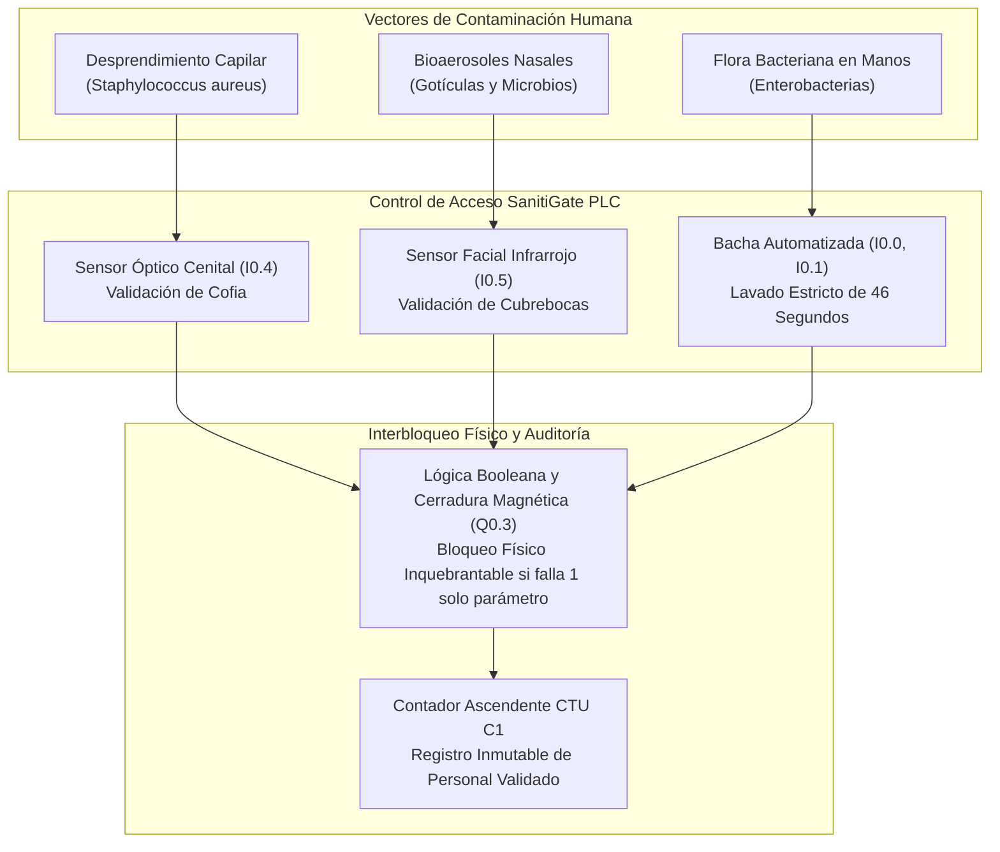

# INFORME TÉCNICO DE INGENIERÍA DE CONTROL Y AUTOMATIZACIÓN INDUSTRIAL
## Sistema Automatizado de Esclusa Sanitaria, Control de Acceso y Validación de Equipos de Protección Personal (EPP)
**Proyecto:** SanitiGate PLC — Control Secuencial Bajo Norma IEC 61131-3  
**Área de Especialidad:** Automatización Industrial, Control de Procesos e Instrumentación  
**Normativas y Estándares Aplicables:** IEC 61131-3 (Programación de Autómatas), ISA-101 (Sistemas HMI), UNE 100713 (Instalaciones en Quirófanos), ISO 14644-1 (Salas Limpias Clase ISO 5-7), Sistema HACCP / BPM (Inocuidad Alimentaria)

---

## 1. Introducción y Justificación de la Automatización

En entornos de alta criticidad aséptica, tales como **Salas de Operaciones (Quirófanos hospitalarios)** y **Líneas de Producción y Envasado de Alimentos**, la contaminación microbiológica y física representa el factor de mayor riesgo operativo. Las *Infecciones del Sitio Quirúrgico (ISQ)* y los brotes por transmisión alimentaria (*Salmonella*, *Listeria monocytogenes*, *Escherichia coli*) tienen como vector primario al personal humano a través de tres mecanismos directos:

1. **Desprendimiento capilar y dérmico:** Caída inadvertida de hebras de cabello y escamas cutáneas portadoras de colonias de *Staphylococcus aureus* (incluidas cepas meticilino-resistentes MRSA).
2. **Emisión de bioaerosoles nasofaríngeos:** Gotículas respiratorias expulsadas al hablar, toser o respirar sin una barrera mecánica adecuada.
3. **Contaminación cruzada por contacto manual:** Flora bacteriana transitoria transferida por manos higienizadas de manera deficiente.



### Justificación frente a la Supervisión Manual
La supervisión basada en inspección visual humana fracasa sistemáticamente por fatiga del personal en turnos rotativos, complacencia y presiones de tiempo. Un sistema gobernado por un **Controlador Lógico Programable (PLC)** erradica el factor de error humano al sustituir el criterio subjetivo por un **interbloqueo mecatrónico estricto**:
* La compuerta electromagnética permanece mecánicamente bloqueada mientras no se complete el 100% de la secuencia normativa.
* La arquitectura *touchless* (cero contacto físico) previene la recontaminación de manos tras la desinfección.
* El autómata registra un historial inalterable de ingresos conformes mediante bloques de conteo industrial.

---

## 2. Marco Normativo y Referencias Industriales

* **UNE 100713 / ISO 14644-1:** Establece los requisitos de ventilación y control de biocontaminación en instalaciones hospitalarias. Clasifica los quirófanos en Clase ISO 5 a ISO 7, exigiendo esclusas de acceso con presión diferencial e higiene obligatoria del equipo quirúrgico.
* **Sistema HACCP (Hazard Analysis and Critical Control Points) / ISO 22000:** Define el acceso del personal como un **Punto Crítico de Control (PCC)** o Prerrequisito Operativo (PPRo), demandando barreras sanitarias infranqueables antes de ingresar a zonas de producto expuesto.
* **Benchmarks Internacionales:** El diseño adopta los principios de las esclusas sanitarias herméticas de plantas de alta tecnología en **Japón** (filosofía *Kaizen* / *Chubo*), **Corea del Sur** (estándares sanitarios de la MFDS) y **China** (normativa de inocuidad GB 14881).

---

## 3. Descripción del Proceso y Arquitectura de Subsistemas

La esclusa opera como un recinto de transferencia unidireccional estructurado en 4 subsistemas funcionales:

```
┌─────────────────────────────────────────────────────────────────────────────────────────────────┐
│                     ARQUITECTURA MODULAR DE LA ESCLUSA SANITARIA SANITIGATE                     │
├──────────────────────────┬──────────────────────────┬──────────────────────────┬────────────────┤
│ Subsistema 1: Cofia      │ Subsistema 2: Cubrebocas │ Subsistema 3: Manos      │ Subsistema 4:  │
│ Sensor Cenital (I0.4)    │ Sensor Facial (I0.5)     │ Secuencia 5 Etapas (46s) │ Acceso Total   │
└──────────────────────────┴──────────────────────────┴──────────────────────────┴────────────────┘
```

### 3.1. Subsistema 1: Verificación de Cobertura Capilar (Cofia / Gorro)
* **Instrumentación:** Sensor óptico de visión artificial cenital (`I0.4`).
* **Principio Operativo:** Discrimina la reflectancia espectral y textura del polipropileno no tejido (*spunbond*) frente a la queratina del cabello humano.
* **Criterio Lógico:** Requiere una cobertura superior al 98% de la cabeza (`I0.4 = 1`). Si detecta cabello expuesto (`I0.4 = 0`), activa la baliza de bloqueo y cancela la secuencia.

### 3.2. Subsistema 2: Verificación de Cubrebocas (Mascarilla Facial)
* **Instrumentación:** Sensor infrarrojo cercano de perfil facial (`I0.5`).
* **Principio Operativo:** Reconocimiento de contraste geométrico que audita el sellado hermético desde el tabique nasal hasta el mentón.
* **Criterio Lógico:** Nivel lógico 1 únicamente si la mascarilla cubre completamente nariz y boca. Mascarillas mal ajustadas o bajo la nariz son evaluadas como nivel lógico 0.

### 3.3. Subsistema 3: Higiene Secuencial de Manos (Ciclo de 46 Segundos)
Gobernado por 5 etapas temporizadas de ejecución obligatoria y excluyente:

```mermaid
gantt
    title Cronograma Secuencial del Protocolo de Higiene (46 Segundos Totales)
    dateFormat X
    axisFormat %s s

    section 1. Dosificación
    Electroválvula Jabón (Q0.0) :active, 0, 3

    section 2. Frotado
    Baliza Amarilla / Fricción Mecánica (Q0.5) :crit, 3, 23

    section 3. Enjuague
    Electroválvula Agua Templada (Q0.1) :active, 23, 33

    section 4. Desinfección
    Atomizador Spray Hidroalcohólico (Q0.2) :active, 33, 36

    section 5. Paso
    Cerradura Libre y Baliza Verde (Q0.3) :done, 36, 46
```



1. **Etapa 1 — Dosificación de Jabón (`Q0.0` - 3s):** Se energiza la electroválvula de jabón antiséptico mediante el temporizador `TON T1` ($PT = 3.0\,\text{s}$).
2. **Etapa 2 — Frotado Mecánico con Baliza Amarilla (`Q0.5` - 20s):** Fricción obligatoria de manos según la técnica de la OMS. Se enciende la baliza ámbar (`Q0.5`) bajo el temporizador `TON T2` ($PT = 20.0\,\text{s}$). Las boquillas de agua permanecen inactivas para asegurar el tiempo de contacto del tensioactivo.
3. **Etapa 3 — Enjuague con Agua Templada (`Q0.1` - 10s):** Apertura de la electroválvula de agua mediante `TON T3` ($PT = 10.0\,\text{s}$) para arrastre mecánico de jabón y detritos microbianos.
4. **Etapa 4 — Atomización de Spray Desinfectante (`Q0.2` - 3s):** Nebulización de alcohol al 70% mediante la microbomba atomizadora temporizada por `TON T4` ($PT = 3.0\,\text{s}$).
5. **Etapa 5 — Desbloqueo de Puerta y Baliza Verde (`Q0.3` - 10s):** Al completarse los 36s previos, el PLC desenergiza el electroimán de retención, enciende la baliza verde (`Q0.3`) y arranca `TON T5` ($PT = 10.0\,\text{s}$) para permitir el ingreso peatonal.

### 3.4. Mecanismo de Seguridad Anti-Abandono y Anti-Tamper
Si el operario retira las manos del sensor óptico (`I0.1 = 0`) o se quita la cofia o la mascarilla durante las etapas 1 a 4:
* Los temporizadores $T_1$ a $T_4$ se restablecen inmediatamente a $0.0\,\text{s}$.
* Todas las electroválvulas se cierran.
* La cerradura electromagnética permanece energizada (puerta bloqueada).
* Se emite una señal de alarma y el ciclo debe reiniciarse íntegramente desde cero.

---

## 4. Mapa de Entradas y Salidas del Autómata (Tabla I/O)

Todas las señales digitales de campo corresponden al estándar industrial de **24V DC**:

| Dirección PLC | Variable Simbólica | Naturaleza Eléctrica | Instrumento / Dispositivo Físico | Estado de Reposo | Descripción Funcional |
| :---: | :---: | :---: | :---: | :---: | :--- |
| **`I0.0`** | `SENS_PRESENCIA` | Entrada Digital 24V DC | Sensor fotoeléctrico difuso / Tapete piezoeléctrico | NA (Normal Abierto) | Detecta la presencia física del operario en la estación. |
| **`I0.1`** | `SENS_MANOS` | Entrada Digital 24V DC | Barrera óptica infrarroja modulada bajo bacha | NA (Normal Abierto) | Detecta las manos situadas bajo el haz de lavado. |
| **`I0.2`** | `STOP_NORMAL` | Entrada Digital 24V DC | Pulsador rasante industrial IP65 | NC en campo / NA soft | Orden de parada controlada del sistema a reposo. |
| **`I0.3`** | `PARO_EMERGENCIA` | Entrada Digital 24V DC | Pulsador hongo con retención mecánica | NC (Seguridad Positiva) | Corte de emergencia: desenergiza actuadores y bloquea acceso. |
| **`I0.4`** | `SENS_COFIA` | Entrada Digital 24V DC | Sensor de visión / Cámara industrial cenital | NA (Transistor PNP) | Nivel 1 = Cobertura capilar conforme. Nivel 0 = Falla. |
| **`I0.5`** | `SENS_CUBREBOCAS` | Entrada Digital 24V DC | Sensor infrarrojo de perfil facial | NA (Transistor PNP) | Nivel 1 = Sellado nasobucal correcto. Nivel 0 = Falla. |
| **`Q0.0`** | `VALV_JABON` | Salida Digital 24V DC | Electroválvula solenoide 24V DC | NC (Desenergizada) | Dosificación de jabón antiséptico (3 s). |
| **`Q0.1`** | `VALV_AGUA` | Salida Digital 24V DC | Electroválvula de diafragma 24V DC | NC (Desenergizada) | Suministro de agua para enjuague continuo (10 s). |
| **`Q0.2`** | `BOMBA_SPRAY` | Salida Digital 24V DC | Microbomba atomizadora 24V DC | NC (Desenergizada) | Pulverización de desinfectante hidroalcohólico (3 s). |
| **`Q0.3`** | `CERRADURA_VERDE` | Salida Digital 24V DC | Electroimán de 600 lbs + Baliza Verde | Relé de Potencia 10A | Desbloqueo de compuerta y señal verde de paso (10 s). |
| **`Q0.4`** | `BALIZA_ROJA` | Salida Digital 24V DC | Baliza semáforo industrial roja (ISA-101) | Relé / Transistor PNP | Señalización de esclusa bloqueada / paso prohibido. |
| **`Q0.5`** | `BALIZA_AMARILLA`| Salida Digital 24V DC | Baliza semáforo industrial ámbar (ISA-101) | Relé / Transistor PNP | Indicador de frotado recíproco obligatorio en curso (20 s). |

---

## 5. Ingeniería de Control: Lógica Ladder (IEC 61131-3)

La lógica del autómata programable está estructurada en **22 Networks (Renglones Lógicos)** bajo norma IEC 61131-3:

```
  L+ (24V)                                                                          M (0V)
    │                                                                                 │
N1  ├──[ / ] I0.3 ──────[ / ] I0.2 ──────────────────────────────────────────(   ) M_RUN
    │  (Emergencia)    (Stop Normal)                                         (Seguridad OK)
    │
N2  ├──[   ] I0.4 ──────[   ] I0.5 ──────────────────────────────────────────(   ) M_EPP_OK
    │  (Cofia OK)      (Cubrebocas OK)                                       (EPP Conforme)
    │
N3  ├──[   ] M_RUN ─────[   ] M_EPP_OK ───[   ] I0.0 ───[   ] I0.1 ─[ / ] M0.5 (S) M0.0
    │  (Seguridad)     (EPP Conforme)    (Presencia)(Manos) (No Valid) (Ciclo Iniciado)
    │
N4  ├──[ / ] Q0.3 ───────────────────────────────────────────────────────────(   ) Q0.4
    │  (Puerta No Libre)                                                     (Baliza Roja)
    │
N5  ├──[   ] M0.0 ──────[ / ] T1.DN ──────[   ] I0.0 ───[   ] I0.1 ──────────(   ) Q0.0
    │  (Ciclo Activo)  (T1 No Listo)     (Presencia)(Manos)                 (Jabón 3s)
    │
N6  ├──[   ] M0.0 ───────────────────────────────────────────────────────────[TON T1: 3.0s]
    │  (Ciclo Activo)
    │
N7  ├──[   ] T1.DN ─────[ / ] T2.DN ──────[   ] I0.1 ────────────────────────(   ) Q0.5
    │  (Jabón Listo)   (T2 No Listo)     (Manos Presentes)                  (Baliza Amarilla)
    │
N8  ├──[   ] T1.DN ──────────────────────────────────────────────────────────[TON T2: 20.0s]
    │  (Habilitar Frotado)
    │
N9  ├──[   ] T2.DN ─────[ / ] T3.DN ──────[   ] I0.1 ────────────────────────(   ) Q0.1
    │  (Frotado Listo) (T3 No Listo)     (Manos Presentes)                  (Agua 10s)
    │
N10 ├──[   ] T2.DN ──────────────────────────────────────────────────────────[TON T3: 10.0s]
    │  (Habilitar Agua)
    │
N11 ├──[   ] T3.DN ─────[ / ] T4.DN ──────[   ] I0.1 ────────────────────────(   ) Q0.2
    │  (Enjuague Listo)(T4 No Listo)     (Manos Presentes)                  (Spray 3s)
    │
N12 ├──[   ] T3.DN ──────────────────────────────────────────────────────────[TON T4: 3.0s]
    │  (Habilitar Spray)
    │
N13 ├──[   ] T4.DN ──────────────────────────────────────────────────────────(S) M0.5
    │  (Spray Concluido)                                                     (Lavado OK)
    │
N14 ├──[   ] M0.5 ──────[   ] I0.4 ───────[   ] I0.5 ────────────────────────(S) M_ACCESS
    │  (Lavado OK)     (Cofia OK)        (Cubrebocas OK)                     (Acceso Concedido)
    │
N15 ├──[   ] M_ACCESS ───────────────────────────────────────────────────────[TON T5: 10.0s]
    │  (Acceso Concedido)
    │
N16 ├──[   ] M_ACCESS ──[ / ] T5.DN ─────────────────────────────────────────(   ) Q0.3
    │  (Acceso Concedido)(T5 No Listo)                                       (Cerradura Libre)
    │
N17 ├──[ P ] M_ACCESS ───────────────────────────────────────────────────────[CTU C1: +1]
    │  (Flanco Ascendente)                                                   (Auditoría)
    │
N18 ├──[   ] T5.DN ──────────────────────────────────────────────────────────(R) M_ACCESS
    │  (Fin de Tiempo de Cruce)                                              (R) M0.5
    │                                                                        (R) M0.0
    │
N19 ├──[   ] I0.0 ──────[ / ] M_EPP_OK ──────────────────────────────────────(S) M0.8
    │  (En Esclusa)    (Falla EPP)                                           (Alarma EPP)
    │
N20 ├──[   ] M0.8 ───────────────────────────────────────────────────────────(R) M0.0
    │  (Alarma EPP)                                                          (R) M_ACCESS
    │
N21 ├──[   ] M0.0 ──────[ / ] M0.5 ───────[ / ] I0.1 ────────────────────────(S) M0.6
    │  (Ciclo Activo)  (No Validado)     (Manos Retiradas)                  (Alarma Abandono)
    │
N22 ├──[   ] M0.6 ───────────────────────────────────────────────────────────(R) M0.0
    │  (Alarma Abandono)                                                     (Reset a 0s)
    │
```

---

## 6. Modelado Matemático y Matriz de Verdad

### 6.1. Ecuaciones Booleanas de Gobierno
$$\begin{aligned}
M_{EPP} &= I_{0.4} \cdot I_{0.5} \\
S_{M0.0} &= M_{RUN} \cdot M_{EPP} \cdot I_{0.0} \cdot I_{0.1} \cdot \overline{M_{0.5}} \\
Q_{0.0} \,(\text{Jabón}) &= M_{0.0} \cdot \overline{T_{1}.Q} \cdot I_{0.0} \cdot I_{0.1} \\
Q_{0.5} \,(\text{Baliza Amarilla / Frotado}) &= M_{0.0} \cdot T_{1}.Q \cdot \overline{T_{2}.Q} \cdot I_{0.1} \\
Q_{0.1} \,(\text{Agua}) &= M_{0.0} \cdot T_{2}.Q \cdot \overline{T_{3}.Q} \cdot I_{0.1} \\
Q_{0.2} \,(\text{Spray}) &= M_{0.0} \cdot T_{3}.Q \cdot \overline{T_{4}.Q} \cdot I_{0.1} \\
M_{0.5} &= \text{Set}(T_{4}.Q) \\
M_{ACCESS} &= M_{0.5} \cdot I_{0.4} \cdot I_{0.5} \\
Q_{0.3} \,(\text{Cerradura Libre y Baliza Verde}) &= M_{ACCESS} \cdot \overline{T_{5}.Q} \\
Q_{0.4} \,(\text{Baliza Roja de Bloqueo}) &= \overline{Q_{0.3}} \\
R_{\text{Total}} &= (M_{0.0} \cdot \overline{M_{0.5}} \cdot \overline{I_{0.1}}) + (M_{0.0} \cdot \overline{M_{EPP}}) + I_{0.2} + I_{0.3}
\end{aligned}$$

### 6.2. Matriz de Verdad Operativa

| Estado | Cofia ($I_{0.4}$) | Cubrebocas ($I_{0.5}$) | Presencia ($I_{0.0}$) | Manos ($I_{0.1}$) | Lavado Concluido ($M_{0.5}$) | Cerradura / Verde ($Q_{0.3}$) | Baliza Roja ($Q_{0.4}$) | Diagnóstico del Autómata |
| :---: | :---: | :---: | :---: | :---: | :---: | :---: | :---: | :--- |
| **A** | 0 | 0 | 0 | 0 | 0 | **0** | **1** | Reposo: esclusa vacía y enclavada. |
| **B** | **0** | 1 | 1 | 1 | 0 | **0** | **1** | **Bloqueo:** Infracción capilar detectada por $I_{0.4}$. |
| **C** | 1 | **0** | 1 | 1 | 0 | **0** | **1** | **Bloqueo:** Infracción respiratoria detectada por $I_{0.5}$. |
| **D** | 1 | 1 | 1 | **0** | 0 | **0** | **1** | **Espera:** Operario presente, sin manos en bacha. |
| **E** | 1 | 1 | 1 | 1 | **0** | **0** | **1** | **En ejecución:** Ciclo de lavado en proceso (bloqueado). |
| **F** | 1 | 1 | 1 | **0** *(retiró)* | 0 | **0** | **1** | **Infracción:** Manos retiradas antes de tiempo. Reset a 0s. |
| **G** | **0** *(se quitó)* | 1 | 1 | - | 1 | **0** | **1** | **Infracción:** Lavado concluido pero se retiró la cofia. |
| **H** | 1 | **0** *(se quitó)* | 1 | - | 1 | **0** | **1** | **Infracción:** Lavado concluido pero se bajó la mascarilla. |
| **I** | **1** | **1** | **1** | **-** | **1** | **1** | **0** | <span style="color:#16A34A; font-weight:bold;">¡ACCESO AUTORIZADO! Puerta liberada 10s ($C_1 + 1$).</span> |

---

## 7. Interfaz Hombre-Máquina (HMI) y Filosofía ISA-101

El sistema implementa una interfaz conforme a la norma **ISA-101 (Human-Machine Interface for Process Automation Systems)**:
* **Jerarquía de Alto Contraste:** Fondo gris claro sanitario (`#F8FAFC`) con superficies de trabajo blancas (`#FFFFFF`) para mitigar la fatiga visual en turnos prolongados.
* **Codificación de Estados por Semáforo ISA-101:**
  * 🔴 **Rojo (`#DC2626` - `Q0.4`):** Estado prohibitivo (puerta energizada / bloqueada).
  * 🟡 **Ámbar (`#F59E0B` - `Q0.5`):** Estado de advertencia y proceso activo (frotado mecánico de 20s).
  * 🟢 **Verde (`#16A34A` - `Q0.3`):** Condición segura alcanzada (acceso autorizado / puerta desenergizada libre).
* **Supervisión de Insumos y Fluidos:**
  * Jabón: `#38BDF8` (Azul celeste).
  * Agua: `#0EA5E9` (Azul cian).
  * Spray desinfectante: `#14B8A6` (Verde menta antiséptico).
* **Registro Histórico SCADA:** Terminal de eventos con estampado de tiempo en milisegundos para trazabilidad de incidencias (`[STEP]`, `[ALARM]`, `[SAFE]`, `[INFO]`).

---

## 8. Esquema de Acondicionamiento Electrónico y Simulación en Proteus VSM

```
                  CIRCUITO DE ENTRADA INDUSTRIAL OPTOTRANSPORTADO (PC817)
              +24V DC Campo
                  │
                 [ ] Sensor Industrial PNP (Cofia, Cubrebocas, Presencia, Manos)
                  │
                  ├───[ R1: 2.2 kΩ, 1W ]───┐
                                           ▼ Anodo PC817
                                         ┌────┐
                                         │    │ (Optoacoplador)
                                         └────┘
                                           ▲ Cátodo
                  ┌────────────────────────┴────────────────────────┐
                 GND 24V Campo                                    GND 5V TTL
                                                                    │
                                                                  [ R2: 10 kΩ Pull-Down ]
                                                                    │
                                                                    ├─── Hacia Pin MCU (PIC / ATmega)

                  CIRCUITO DE SALIDA DE POTENCIA CON DRIVER ULN2803
               Pin MCU (5V) ───[ 1 kΩ ]───► Base Entrada ULN2803
                                                   │
                                             Colector Abierto
                                                   │
                                                   ├─── Bobina Relé 24V DC ─── +24V DC Campo
                                                   │
                                                [▲ Diodo 1N4007 Antiparalelo]
                                                   │
                                                 +24V DC Campo
```

### 8.1. Mapeo de Terminales para Microcontroladores

| Señal PLC | Función en Esclusa | Pin PIC16F877A | Pin ATmega328P / Arduino | Acondicionamiento Electrónico en Proteus |
| :---: | :--- | :---: | :---: | :--- |
| **`I0.0`** | Sensor Presencia | PORTB.0 (Pin 33) | Pin D2 (INT0) | Optoacoplador PC817 con resistencia Pull-Down de 10 kΩ |
| **`I0.1`** | Sensor Manos | PORTB.1 (Pin 34) | Pin D3 (INT1) | Optoacoplador PC817 con resistencia Pull-Down de 10 kΩ |
| **`I0.2`** | Stop Normal | PORTB.2 (Pin 35) | Pin D4 | Pulsador rasante industrial con Pull-Down de 10 kΩ |
| **`I0.3`** | Paro de Emergencia | PORTB.3 (Pin 36) | Pin D5 | Hongo NC con Pull-Up a 5V (Lógica de seguridad positiva) |
| **`I0.4`** | Sensor Cofia | PORTB.4 (Pin 37) | Pin D6 | PC817 aislado con Pull-Down de 10 kΩ (Salida de cámara) |
| **`I0.5`** | Sensor Cubrebocas | PORTB.5 (Pin 38) | Pin D7 | PC817 aislado con Pull-Down de 10 kΩ (Salida de cámara) |
| **`Q0.0`** | Electroválvula Jabón | PORTD.0 (Pin 19) | Pin D8 | Driver Darlington ULN2803 + Relé 24V DC + Diodo 1N4007 |
| **`Q0.1`** | Electroválvula Agua | PORTD.1 (Pin 20) | Pin D9 | Driver Darlington ULN2803 + Relé 24V DC + Diodo 1N4007 |
| **`Q0.2`** | Bomba Spray Alcohol | PORTD.2 (Pin 21) | Pin D10 | Driver Darlington ULN2803 + Relé 24V DC + Diodo 1N4007 |
| **`Q0.3`** | Cerradura + Luz Verde | PORTD.3 (Pin 22) | Pin D11 | Driver ULN2803 + Relé de Potencia 10A (Solenoide 600 lbs) |
| **`Q0.4`** | Baliza Roja | PORTD.4 (Pin 27) | Pin D12 | Driver ULN2803 + Lámpara / Baliza LED 24V DC (ISA-101) |
| **`Q0.5`** | Baliza Amarilla | PORTD.5 (Pin 28) | Pin D13 | Driver ULN2803 + Lámpara / Baliza LED 24V DC (ISA-101) |

---

## 9. Firmware Embebido Determinístico (Lenguaje C)

Estructura de máquina de estados finitos (FSM) no bloqueante con temporizadores concurrentes:

```c
// =========================================================================
// SANITIGATE PLC — FIRMWARE DE CONTROL SECUENCIAL E INTERBLOQUEO EPP
// Microcontrolador: ATmega328P / PIC16F877A | Frecuencia de Ciclo: 20 Hz
// =========================================================================

#include <stdint.h>
#include <stdbool.h>

// Definición de Puertos de Entrada (Sensores 24V Optoaislados)
#define PIN_PRESENCIA    2  // I0.0
#define PIN_MANOS        3  // I0.1
#define PIN_STOP         4  // I0.2
#define PIN_EMERGENCIA   5  // I0.3
#define PIN_COFIA        6  // I0.4
#define PIN_CUBREBOCAS   7  // I0.5

// Definición de Puertos de Salida (Actuadores mediante Driver ULN2803)
#define PIN_VALV_JABON   8  // Q0.0 (3s)
#define PIN_VALV_AGUA    9  // Q0.1 (10s)
#define PIN_SPRAY        10 // Q0.2 (3s)
#define PIN_PUERTA_VERDE 11 // Q0.3 (10s)
#define PIN_BALIZA_ROJA  12 // Q0.4 (Bloqueado)
#define PIN_BALIZA_FROT  13 // Q0.5 (Amarilla 20s)

typedef enum {
    ESTADO_REPOSO,
    ESTADO_JABON,
    ESTADO_FROTADO,
    ESTADO_ENJUAGUE,
    ESTADO_SPRAY,
    ESTADO_ACCESO_LIBRE
} EstadoEsclusa;

EstadoEsclusa estadoActual = ESTADO_REPOSO;
unsigned long marcaTiempoEtapa = 0;
uint16_t contadorPersonalAuditado = 0;

void setup() {
    // Configuración de pines de entrada con resistencia de referencia
    pinMode(PIN_PRESENCIA, INPUT);
    pinMode(PIN_MANOS, INPUT);
    pinMode(PIN_STOP, INPUT);
    pinMode(PIN_EMERGENCIA, INPUT_PULLUP);
    pinMode(PIN_COFIA, INPUT);
    pinMode(PIN_CUBREBOCAS, INPUT);

    // Configuración de pines de salida de potencia
    pinMode(PIN_VALV_JABON, OUTPUT);
    pinMode(PIN_VALV_AGUA, OUTPUT);
    pinMode(PIN_SPRAY, OUTPUT);
    pinMode(PIN_PUERTA_VERDE, OUTPUT);
    pinMode(PIN_BALIZA_ROJA, OUTPUT);
    pinMode(PIN_BALIZA_FROT, OUTPUT);

    apagarActuadoresFluidos();
    digitalWrite(PIN_BALIZA_ROJA, HIGH); // Estado seguro: puerta bloqueada
}

void loop() {
    // 1. Lectura y acondicionamiento de señales discretas
    bool presencia  = digitalRead(PIN_PRESENCIA);
    bool manos      = digitalRead(PIN_MANOS);
    bool stop       = digitalRead(PIN_STOP);
    bool emergencia = !digitalRead(PIN_EMERGENCIA); // Lógica negativa de seguridad
    bool cofia      = digitalRead(PIN_COFIA);
    bool cubrebocas = digitalRead(PIN_CUBREBOCAS);

    bool eppConforme = cofia && cubrebocas;

    // 2. Interbloqueo de Seguridad Crítica (Paro / Emergencia)
    if (emergencia || stop) {
        estadoActual = ESTADO_REPOSO;
        apagarActuadoresFluidos();
        digitalWrite(PIN_PUERTA_VERDE, LOW);
        digitalWrite(PIN_BALIZA_ROJA, HIGH);
        return;
    }

    // 3. Interbloqueo Anti-Violación de EPP en pleno ciclo
    if (estadoActual != ESTADO_REPOSO && !eppConforme) {
        estadoActual = ESTADO_REPOSO; // Aborto inmediato a 0s
        apagarActuadoresFluidos();
        digitalWrite(PIN_PUERTA_VERDE, LOW);
        digitalWrite(PIN_BALIZA_ROJA, HIGH);
        return;
    }

    // 4. Interbloqueo Anti-Abandono de Manos
    if (estadoActual != ESTADO_REPOSO && estadoActual != ESTADO_ACCESO_LIBRE && !manos) {
        estadoActual = ESTADO_REPOSO; // Aborto inmediato a 0s
        apagarActuadoresFluidos();
        digitalWrite(PIN_PUERTA_VERDE, LOW);
        digitalWrite(PIN_BALIZA_ROJA, HIGH);
        return;
    }

    unsigned long tiempoActual = millis();
    unsigned long deltaTiempo = tiempoActual - marcaTiempoEtapa;

    // 5. Máquina de Estados Finitos Secuencial (FSM)
    switch (estadoActual) {
        case ESTADO_REPOSO:
            digitalWrite(PIN_BALIZA_ROJA, HIGH);
            digitalWrite(PIN_PUERTA_VERDE, LOW);
            // Arranque solo si hay presencia, manos y EPP completo
            if (presencia && manos && eppConforme) {
                estadoActual = ESTADO_JABON;
                marcaTiempoEtapa = millis();
                digitalWrite(PIN_VALV_JABON, HIGH); // Iniciar jabón
            }
            break;

        case ESTADO_JABON: // TON T1: 3.0 segundos
            if (deltaTiempo >= 3000) {
                digitalWrite(PIN_VALV_JABON, LOW);
                estadoActual = ESTADO_FROTADO;
                marcaTiempoEtapa = millis();
                digitalWrite(PIN_BALIZA_FROT, HIGH); // Baliza amarilla
            }
            break;

        case ESTADO_FROTADO: // TON T2: 20.0 segundos
            if (deltaTiempo >= 20000) {
                digitalWrite(PIN_BALIZA_FROT, LOW);
                estadoActual = ESTADO_ENJUAGUE;
                marcaTiempoEtapa = millis();
                digitalWrite(PIN_VALV_AGUA, HIGH); // Iniciar agua
            }
            break;

        case ESTADO_ENJUAGUE: // TON T3: 10.0 segundos
            if (deltaTiempo >= 10000) {
                digitalWrite(PIN_VALV_AGUA, LOW);
                estadoActual = ESTADO_SPRAY;
                marcaTiempoEtapa = millis();
                digitalWrite(PIN_SPRAY, HIGH); // Iniciar spray desinfectante
            }
            break;

        case ESTADO_SPRAY: // TON T4: 3.0 segundos
            if (deltaTiempo >= 3000) {
                digitalWrite(PIN_SPRAY, LOW);
                // Verificación final de EPP antes de abrir
                if (eppConforme) {
                    digitalWrite(PIN_BALIZA_ROJA, LOW);
                    digitalWrite(PIN_PUERTA_VERDE, HIGH); // Desbloqueo electroimán
                    contadorPersonalAuditado++;
                    estadoActual = ESTADO_ACCESO_LIBRE;
                    marcaTiempoEtapa = millis();
                } else {
                    estadoActual = ESTADO_REPOSO;
                }
            }
            break;

        case ESTADO_ACCESO_LIBRE: // TON T5: 10.0 segundos de paso peatonal
            if (deltaTiempo >= 10000) {
                digitalWrite(PIN_PUERTA_VERDE, LOW); // Rebloqueo electromagnético
                digitalWrite(PIN_BALIZA_ROJA, HIGH);
                estadoActual = ESTADO_REPOSO; // Retorno a reposo
            }
            break;
    }
}

void apagarActuadoresFluidos() {
    digitalWrite(PIN_VALV_JABON, LOW);
    digitalWrite(PIN_VALV_AGUA, LOW);
    digitalWrite(PIN_SPRAY, LOW);
    digitalWrite(PIN_BALIZA_FROT, LOW);
}
```

---

## 10. Conclusiones de Ingeniería

1. **Eficacia Determinística:** La sustitución de la vigilancia manual por control secuencial mediante autómata programable asegura el cumplimiento del 100% de la técnica higiénica, sin tolerar atajos ni omisiones temporales.
2. **Robustez Mecatrónica de Campo:** La inclusión de un doble interbloqueo lógico (que exige simultáneamente presencia $I_{0.0}$ y contacto visual de manos $I_{0.1}$) previene el accionamiento de fluidos en vacío, resguardando los insumos antisépticos y la integridad de la estación.
3. **Validación Integral de Barrera Biológica:** La conjunción booleana entre la indumentaria de contención capilar ($I_{0.4}$), la barrera nasofaríngea ($I_{0.5}$) y la asepsia química de manos ($M_{0.5}$) convierte a la esclusa en una barrera hermética e inviolable para quirófanos y áreas de inocuidad alimentaria.
4. **Viabilidad de Construcción:** El diseño emplea señales discretas estándar de 24V DC con aislamiento optoelectrónico y cargas desacopladas por transistores Darlington y diodos de libre rueda, permitiendo su fabricación física inmediata tanto con PLCs comerciales (Siemens S7-1200, Omron CP1L) como con microcontroladores embebidos (PIC16F877A, ATmega328P).

---
*Fin del Informe Técnico de Ingeniería — SanitiGate PLC v3.0*
